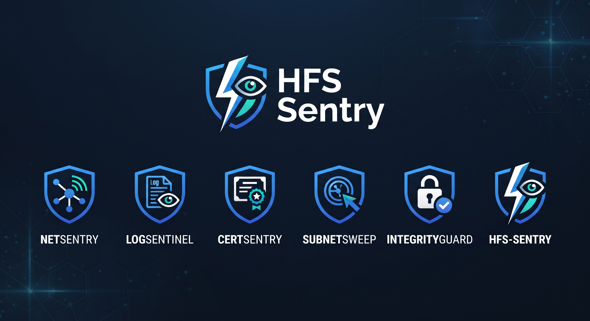
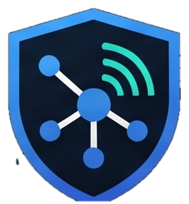

<p align="center">
  
</p>

# HFS-Sentry 🛡️
> **Suite Modular de Ciberseguridad & Diagnóstico de Infraestructuras**  
> *Zero External Dependencies | Pure Standard Python 3 | High-Performance & Low Overhead*

[](LICENSE)
[](https://www.python.org/)
[](CONTRIBUTING.md)
[](pyproject.toml)
[](https://github.com/faathii/HFS-Sentry)

---

## 🌟 Visión & Filosofía

**HFS-Sentry** es un ecosistema de herramientas de seguridad defensiva, auditoría perimetral y análisis forense diseñado para entornos reales y de misión crítica.

* **Cero Dependencias Externas:** Funciona al 100% utilizando únicamente la biblioteca estándar de Python 3 (`socket`, `ssl`, `hashlib`, `concurrent.futures`, `re`, `argparse`, `ipaddress`). Sin sorpresas con gestores de paquetes, sin conflictos de librerías, listo para ejecutarse en servidores aislados (*air-gapped*), contenedores mínimos o sistemas embebidos.
* **Arquitectura 100% Modular y Extensible:** Basado en un patrón de registro dinámico (`BaseTool` + `@register_tool`). Añadir una nueva herramienta en el futuro requiere únicamente crear un archivo e implementar una clase.
* **Doble Modo de Ejecución:** Cada herramienta puede ser invocada de forma centralizada mediante la CLI unificada (`python sentry.py <herramienta>`) o como script independiente (`python -m sentry.tools.<herramienta>`).

---

## 🏛️ Arquitectura Modular

```
                           ┌──────────────────────────┐
                           │    CLI Unificada         │
                           │   (sentry.py / sentry)   │
                           └────────────┬─────────────┘
                                        │
                         ┌──────────────┴──────────────┐
                         ▼                             ▼
              ┌─────────────────────┐       ┌─────────────────────┐
              │  sentry.core.base   │       │ sentry.core.registry│
              │     (BaseTool)      │◄──────┤   (@register_tool)  │
              └──────────┬──────────┘       └──────────┬──────────┘
                         │                             │
       ┌─────────────────┼────────────────┬────────────┴────┬─────────────────┐
       ▼                 ▼                ▼                 ▼                 ▼
 ┌───────────┐     ┌───────────┐    ┌───────────┐     ┌───────────┐     ┌───────────┐
 │ NetSentry │     │LogSentinel│    │CertSentry │     │SubnetSweep│     │ Integrity │
 │ (Network) │     │(Forensic) │    │  (Crypto) │     │ (Infra)   │     │   Guard   │
 └───────────┘     └───────────┘    └───────────┘     └───────────┘     └───────────┘
```

---

## 🧰 Catálogo de Herramientas Integradas

| Herramienta | Categoría | Propósito Técnico | Salida / Capacidad Clave |
| :---: | :--- | :--- | :--- |
| <br>**`netsentry`** | Red & Web | Escáner concurrente de puertos TCP, *banner grabbing* ligero y auditoría de las 6 cabeceras de seguridad OWASP (HSTS, CSP, X-Frame-Options, etc.). | Reporte tabular con calificación (A, B, F) y alerta de puertos de texto plano. |
| <br>**`logsentinel`** | Forense & IDS | Analizador de registros (`auth.log`, `access.log`), detección de fuerza bruta SSH, *Path Traversal* y escáneres web maliciosos. | Reporte de incidentes y script ejecutable `block_threats.sh` con reglas `ufw`/`iptables`. |
| <br>**`certsentry`** | Criptografía | Inspector preventivo de expiración de certificados SSL/TLS X.509, cadena de confianza y verificación de protocolos obsoletos (TLS 1.0/1.1). | Semáforo de días restantes hasta caducidad y verificación de cifrado. |
| <br>**`subnetsweep`** | Infraestructura | Descubridor concurrente de dispositivos en subredes CIDR (/24) mediante sondas TCP/ICMP y mapeo de fabricantes según prefijo OUI IEEE. | Inventario de hosts activos, direcciones MAC y fabricantes detectados. |
| <br>**`integrityguard`** | HIDS / Forense | Monitor de Integridad de Archivos (FIM) con firmas criptográficas SHA-256 para prevenir alteraciones no autorizadas en archivos del sistema. | Detección en milisegundos de modificaciones, eliminaciones y archivos sospechosos. |

---

## 🚀 Instalación y Puesta en Marcha

### Requisitos
* Python 3.9 o superior.
* Sin necesidad de `pip install` para dependencias de terceros.

### Clonar el Repositorio
```bash
git clone https://github.com/faathii/HFS-Sentry.git
cd HFS-Sentry
```

### Comprobar la Suite
```bash
python sentry.py --list
```

### (Opcional) Instalar en Modo Editable
Si deseas usar el comando directo `hfs-sentry` en tu terminal:
```bash
pip install -e .
```

---

## 💻 Guía de Uso Rápido

### 1. NetSentry — Escaneo de Puertos y Auditoría OWASP
```bash
# Escaneo de puertos estándar y auditoría de cabeceras web
python sentry.py netsentry scanme.nmap.org

# Escaneo de puertos específicos con 40 hilos concurrentes
python sentry.py netsentry 192.168.1.1 -p 22,80,443,3306,8080 -t 40

# Salida estructurada en JSON
python sentry.py netsentry example.com --json
```

### 2. LogSentinel — Análisis Forense & IDS
```bash
# Analizar registros de autenticación SSH
python sentry.py logsentinel examples/sample_auth.log

# Analizar registros web de Nginx/Apache con umbral de 3 fallos
python sentry.py logsentinel examples/sample_access.log --threshold 3

# Generar script de defensa personalizado para el cortafuegos
python sentry.py logsentinel /var/log/auth.log -o ban_ips.sh
```

### 3. CertSentry — Auditoría de Certificados SSL/TLS
```bash
# Inspeccionar caducidad y cifrados de un dominio
python sentry.py certsentry google.com

# Inspeccionar puerto TLS alternativo
python sentry.py certsentry midominio.com -p 8443
```

### 4. SubnetSweep — Inventario de Red Local
```bash
# Barrido concurrente de una subred local /24
python sentry.py subnetsweep 192.168.1.0/24

# Barrido con 60 hilos concurrentes sin ICMP (solo sondas TCP)
python sentry.py subnetsweep 10.0.0.0/24 -t 60 --no-icmp
```

### 5. IntegrityGuard — Monitor de Integridad (FIM)
```bash
# 1. Crear línea base criptográfica de archivos críticos
python sentry.py integrityguard --init -t /etc/passwd /etc/shadow /etc/hosts -b mi_baseline.json

# 2. Verificar integridad periódicamente contra la línea base
python sentry.py integrityguard --check -b mi_baseline.json
```

---

## 🧩 Cómo Añadir Nuevas Herramientas (Guía para Desarrolladores)

Añadir una nueva utilidad técnica a HFS-Sentry es extremadamente sencillo:

1. Crea un nuevo archivo en `sentry/tools/`, por ejemplo `sentry/tools/whoissentry.py`:
```python
import argparse
from sentry.core.base import BaseTool
from sentry.core.registry import register_tool

@register_tool
class WhoisSentryTool(BaseTool):
    name = "whoissentry"
    description = "Consulta y parseo ligero de registros WHOIS"
    author = "Tu Nombre"
    version = "1.0.0"
    category = "OSINT"

    def register_arguments(self, parser: argparse.ArgumentParser) -> None:
        parser.add_argument("domain", help="Dominio a consultar")

    def run(self, args: argparse.Namespace) -> int:
        print(f"Consultando WHOIS para {args.domain}...")
        return 0
```
2. Importa la clase en `sentry/tools/__init__.py`:
```python
from sentry.tools.whoissentry import WhoisSentryTool
```
3. ¡La herramienta queda registrada automáticamente en `python sentry.py --list` y en la ayuda general!

Para más información, consulta la [Guía de Contribución](CONTRIBUTING.md).

---

## 🧪 Pruebas Automatizadas

El proyecto incluye una suite de pruebas unitarias que no requiere librerías externas:

```bash
python -m unittest discover tests -v
```

---

## 🤝 Comunidad & Código Abierto

Este proyecto sigue las mejores prácticas de la comunidad Open Source:
* [Código de Conducta (Code of Conduct)](CODE_OF_CONDUCT.md)
* [Guía de Contribución (Contributing)](CONTRIBUTING.md)
* [Licencia MIT](LICENSE)

---

## 👤 Autor

* **faathii**
  * Certificado en Ciberseguridad por Cisco Networking Academy
  * Grado en Ingeniería Informática (UNED)
  * GitHub: [@faathii](https://github.com/faathii)
  * Repositorio: [https://github.com/faathii/HFS-Sentry](https://github.com/faathii/HFS-Sentry)

